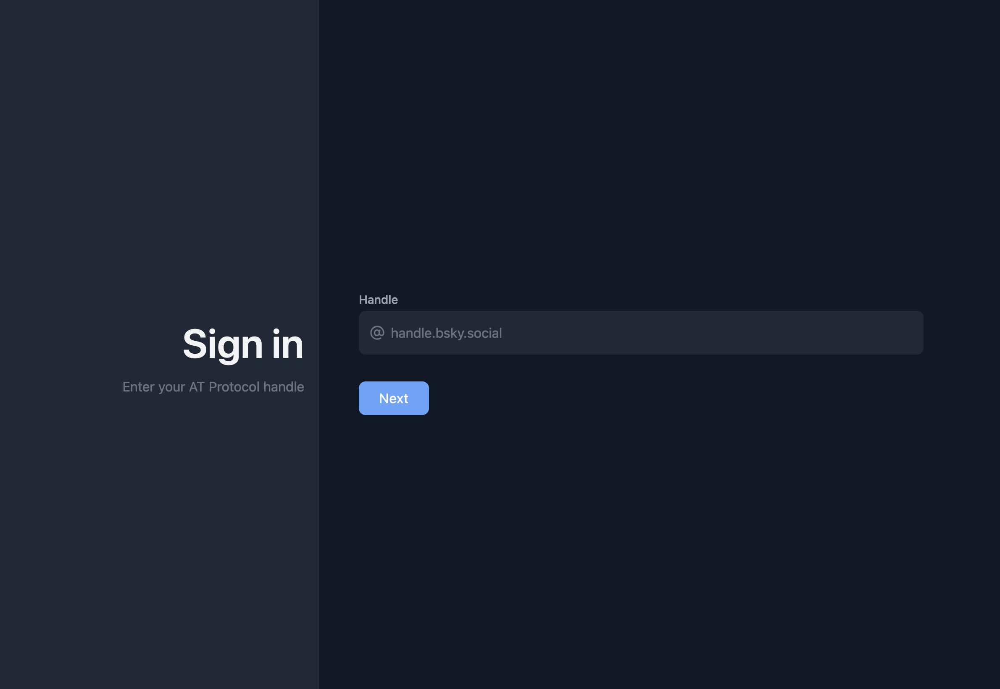
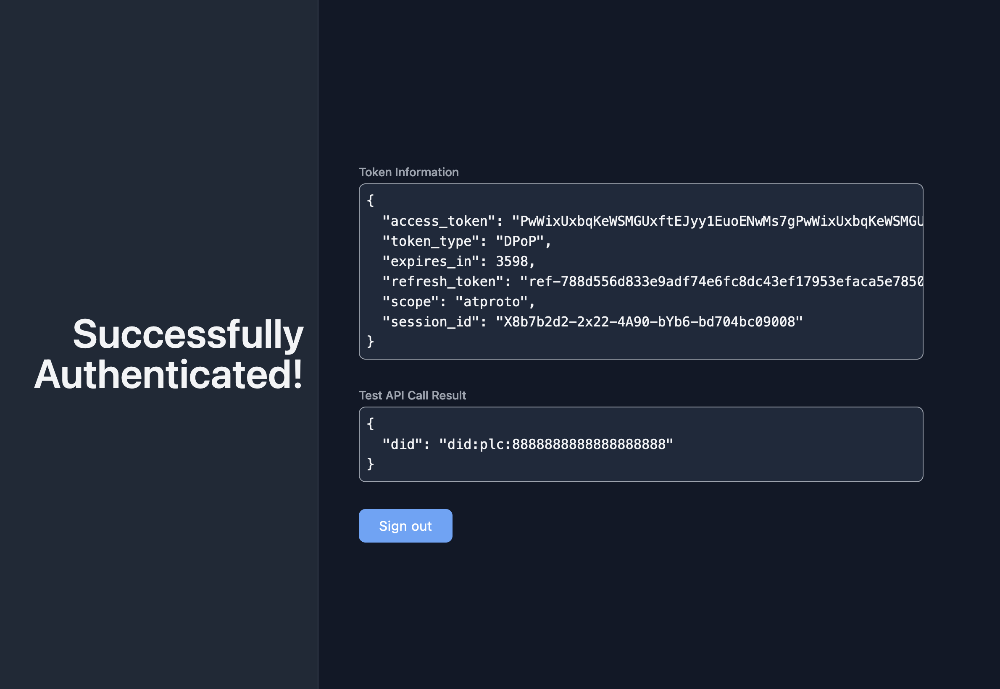

# Basic OAuth webapp client example

This is an example implementation of a simple webapp with an OAuth client for the AT Protocol using the AuthProto gem. It demonstrates how to implement the OAuth flow for a web application. Can be run both as a public and a confidential client.




## Overview

The example implements a simple web application using Sinatra which:

- Allows a user to log in using their AT Protocol @handle
- Implements the complete OAuth authorization flow
- Shows how to make authenticated API calls to Bluesky, displaying account info and letting the user make a test Bluesky post
- Allows you to choose a storage configuration for session management
- Supports running on localhost (as a public client) and on a live domain (as public or confidential client)

## Requirements

- Ruby 3.3+
- a domain name and an SSL certificate for your application for live deployment

## Setup

1. Clone the repository and navigate to the example app directory:

```bash
cd examples/basic_webapp
```

2. Install dependencies:

```bash
bundle install
```


## Client metadata

An ATProto OAuth app needs to have a [Client Metadata JSON file](https://atproto.com/specs/oauth#client-id-metadata-document), which configures the app's security settings and some user-facing info. This JSON file is normally hosted at the `/oauth-client-metadata.json` path. This app includes such endpoint, and reads the contents of the JSON to serve there from a file at `config/oauth-client-metadata.json`.

The configuration differs for localhost testing and a production site:

For localhost testing:

- Create a metadata file from the included **<u>localhost</u>** example:
    ```bash
    cp config/oauth-client-metadata.localhost.json config/oauth-client-metadata.json
    ```
    Here, this file is only used by the app to read the redirect URI and scope from there – it's not accessed by the authorization server.

For a live version:

- Create a metadata file from the included **<u>production</u>** example:
    ```bash
    cp config/oauth-client-metadata.production.json config/oauth-client-metadata.json
    ```
- Replace the `YOUR_DOMAIN_HERE` in the URLs with the hostname where your app will be hosted
- If you want to use the app as a confidential client, generate the signing keys for client authentication (client assertions):
    ```bash
    bundle exec ruby scripts/generate_keys.rb
    ```
    and copy the private and public keys to `config/keys.json` and `config/oauth-client-metadata.json` respectively.
- Otherwise, if you want to run it as a public client:
  - change `token_endpoint_auth_method` in the metadata JSON to `"none"`
  - remove the `token_endpoint_auth_signing_alg` line
  - remove the `jwks` section

## App configuration

Apart from the `oauth-client-metadata.json` & `keys.json` files, the app is configured through ENV variables. You can set them through `export` on the command line, but it also has [dotenv](https://github.com/bkeepers/dotenv) set up, so you can put the config vars in a file named `.env`.

You will need:

### 1. Session & encryption keys

Generate them like this:

```bash
openssl rand -base64 32
openssl rand -hex 32

cat > .env
ATPROTO_MASTER_KEY=<base64 value from first command>
SESSION_SECRET=<hex value from second command>
```

`ATPROTO_MASTER_KEY` is used by AuthProto to encrypt some of the stored session/nonce data in the configured storage; `SESSION_SECRET` is used by `Rack::Session::Cookie` for the browser session.

### 2. Storage configuration

AuthProto includes three storage backends:

* SQLite database
* Redis database
* transient in-memory storage (lost on restart)

In this example app, use these env vars to configure the storage:

    # Select a storage backend: memory (default), sqlite, or redis
    STORAGE_BACKEND=sqlite

    # Optional SQLite path (defaults to ./db/authproto.sqlite3)
    SQLITE_PATH=/var/lib/my-app/authproto.sqlite3

    # Required when STORAGE_BACKEND=redis
    REDIS_URL=redis://localhost:6379

### 3. Host authorization

When running the app on a live domain, set `PERMITTED_DOMAIN` env var to that domain. This is passed to the [:host_authorization](https://sinatrarb.com/intro.html#available-settings) option in Sinatra, which uses it to configure the [Rack::Protection::HostAuthorization](https://github.com/sinatra/sinatra/blob/main/rack-protection/lib/rack/protection/host_authorization.rb) middleware.

    PERMITTED_DOMAIN=your.domain.com

Remember to also set that domain in the URLs in `oauth-client-metadata.json` under `client_id` & `redirect_uris`.


## Running the Application

### Development

```bash
bundle exec rackup
```

### Production

```bash
RACK_ENV=production bundle exec rackup
```

This will start the server on `http://localhost:9292`. For a live deployment, the application must be accessible from the Internet for OAuth to work – the Authorization Server (PDS or entryway) needs to be able to load your `oauth-client-metadata.json` file before you can start the OAuth flow – so you will need to configure e.g. Nginx or Caddy to route requests from a given domain to your app, or use something like Passenger inside Nginx/Apache.


### Tailscale

Alternatively, you can use a **Tailscale Funnel** to expose your local development server to the Internet:

1. Install Tailscale, sign in, and follow the [Funnel setup instructions](https://tailscale.com/docs/features/tailscale-funnel), including enabling MagicDNS.
2. Start your Funnel in a separate terminal, and follow any prompts to enable Funnel and HTTPS. Tailscale automatically provisions the HTTPS certificate:
    ```bash
    tailscale funnel 9292
    ```

3. Keep this command running. It prints the public HTTPS URL for your machine, such as https://machinename.xyz.ts.net. ([Funnel command documentation](https://tailscale.com/docs/reference/tailscale-cli/funnel))
4. Update your metadata to use that public URL, e.g.:
    ```
    "client_id": "https://machinename.xyz.ts.net/oauth-client-metadata.json",
    "redirect_uris": ["https://machinename.xyz.ts.net/callback"]
    ```
5. Set `PERMITTED_DOMAIN` to that hostname in the `.env` file:
    ```
    PERMITTED_DOMAIN=machinename.xyz.ts.net
    ```
    or set it in an ENV var in the terminal where you will run the application:
    ```bash
    export PERMITTED_DOMAIN=machinename.xyz.ts.net
    ```

6. Run the application on port 9292 as described above.

Open the public HTTPS URL to use the application – Funnel now forwards requests to your local HTTP server.


### Cloudflare

Another option is a **Cloudflare Quick Tunnel**:

1. Install [cloudflared](https://developers.cloudflare.com/cloudflare-one/connections/connect-networks/downloads/) (no Cloudflare account or domain is required).
2. Start your tunnel in a separate terminal:
    ```bash
    cloudflared tunnel --url http://localhost:9292
    ```
3. Keep this command running. It prints a public HTTPS URL, such as https://random-words.trycloudflare.com; HTTPS is configured automatically.
4. Update your metadata to use that public URL, e.g.:
    ```
    "client_id": "https://random-words.trycloudflare.com/oauth-client-metadata.json",
    "redirect_uris": ["https://random-words.trycloudflare.com/callback"]
    ```
5. Set `PERMITTED_DOMAIN` to that hostname in the `.env` file:
    ```
    PERMITTED_DOMAIN=random-words.trycloudflare.com
    ```
    or set it in an ENV var in the terminal where you will run the application:
    ```bash
    export PERMITTED_DOMAIN=random-words.trycloudflare.com
    ```

6. Run the application on port 9292 as described above.

Then open the public HTTPS URL to use the application. The hostname changes each time you create a Quick Tunnel, so update the metadata and `PERMITTED_DOMAIN`, then restart the application whenever it changes. ([Cloudflare Quick Tunnel documentation](https://developers.cloudflare.com/tunnel/get-started/quick-tunnels/))


## Troubleshooting

Some common issues you might come across:

* Invalid redirect URI
  - Ensure your redirect URI matches exactly what's in your client metadata
  - Check if your domain matches the `client_id` domain
* Invalid client metadata
  - Verify that your client metadata is accessible at the URL specified in `client_id`
  - Check if your JSON is valid and contains all required fields:
    - `grant_types` must include `"authorization_code"` and should include `"refresh_token"` too
    - `response_types` must include `"code"`
    - `scope` must be one string with a space-separated list
    - the scopes must include `atproto`
    - `token_endpoint_auth_method` must be `"none"` for public and `"private_key_jwt"` for confidential clients
    - `token_endpoint_auth_signing_alg` must be `"ES256"` for confidential clients and should not be set for public ones
    - `dpop_bound_access_tokens` must be `true`
    - `jwks` must be included for confidential clients and not included for public ones
* Authorization failed
  - Verify your JWKS configuration
* Storage errors
  - For SQLite storage, verify that the database path is writable
  - For Redis storage, verify Redis connection settings
  - Check Redis SSL configuration, if using encrypted connections
  - Ensure proper Redis authentication credentials, if required
* Session state lost
  - Verify if storage configuration is correct
  - Check that SQLite storage is on persistent local disk
  - Check Redis connection if using Redis storage
  - Check if TTL configuration isn't overridden
  - Check if `ATPROTO_MASTER_KEY` and `SESSION_SECRET` env vars are being set & read correctly


## Walkthrough of the app code

The whole app is contained in the single [app.rb](https://tangled.org/mackuba.eu/authproto/blob/main/examples/basic_webapp/app.rb) file.

Here's what it does:


### Configuration

* verifies that the `SESSION_SECRET` and `config/oauth-client-metadata.json` are provided
* calls `AuthProto.configure` to configure:
  - required HTTP client
  - session storage depending on `STORAGE_BACKEND`
* parses the metadata file and reads some fields like `client_id` and `redirect_uris` from it
* creates an `AuthProto::Client` in one of two ways depending on the configuration
* sets up `Rack::Protection::HostAuthorization` and `Rack::Session::Cookie`


### Helpers

The `helpers do ... end` block defines some helper functions – these are accessible both in the endpoint action methods and in the ERB templates. `load_session` looks up a saved session using a browser session variable if set, and `html_escape` escapes some content in the template for safety.


### GET /

This just renders a landing page template, and redirects to the authorized page if authorized.


### GET /oauth-client-metadata.json

Serves the required metadata JSON file on the production site (this is ignored when testing on localhost).


### POST /authenticate

This endpoint starts the authorization flow:

- calls `AuthProto::Client#authorize` to generate an authorization URL on user's PDS (behind the scenes, this actually submits all required parameters to the server first in a PAR request)
- saves the ID of the new pending session into a browser session variable
- redirects the user's browser to the authorization URL

The user then either approves or rejects the authorization prompt, which redirects them to:


### GET /callback

This endpoint handles the callback and checks the results of the authorization:

- if an error is returned, presents it to the user
- otherwise, passes the authorization codes to `AuthProto::Client#handle_callback` and gets back access tokens
- `handle_callback` also requires us to pass the session ID read back from the browser session – we need to confirm here that this is the same browser session that started the authorization flow a moment earlier


### GET /authorized

The home page for an authorized user:

- looks up the session to check if a user is logged in (and which user)
- refreshes the access token if it's expired or expiring soon
- makes a test authenticated call to `com.atproto.server.checkAccountStatus` and shows the returned account info; this uses:
  - `#auth_headers` to generate authentication headers for a request
  - `#with_nonce_handling` wrapper to handle DPoP nonces and repeat the request if necessary
  - Faraday gem (as an example) to make the requests


### POST /posts

This endpoint makes a test post on Bluesky, with a text submitted from the text area on the authorized home page. It follows similar steps as above to make an authenticated call to the PDS API.


### GET /logout

This deletes the session data from the configured session storage, revokes the access tokens on the authentication server (PDS), and erases the session ID variable from the browser session, returning to the landing page.

